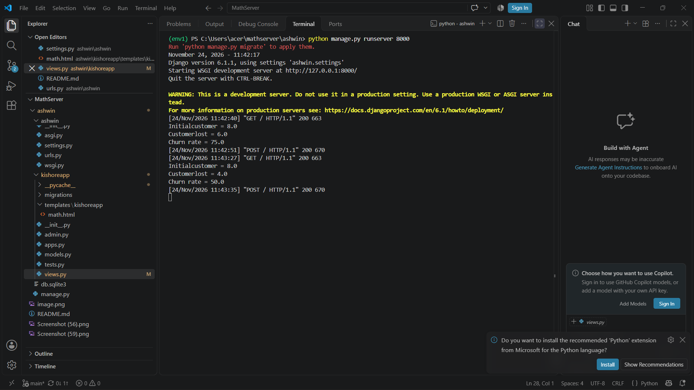
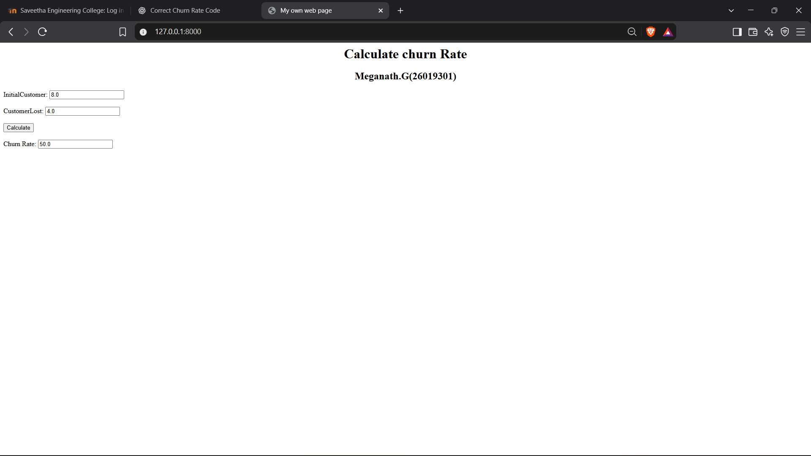

# Ex.03 Design a Website for Server Side Processing
## Date:11.11.26

## AIM:
To create a web page to calculate Churn Rate using server-side scripts.

## FORMULA:
Churn Rate = (CustLost / InitCust) * 100
<br> InitCust --> Initial Customers Count
<br> CustLost --> Customers Lost Count

## DESIGN STEPS:

### Step 1:
Clone the repository from GitHub.

### Step 2:
Create Django Admin project.

### Step 3:
Create a New App under the Django Admin project.

### Step 4:
Create a HTML file to implement form based input and output.

### Step 5:
Create python programs for views and urls to perform server side processing.

### Step 6:
Receive input values from the form using request.POST.get().

### Step 7:
Calculate the Result using the given formula.

### Step 8:
Display the calculated result in the server console.

### Step 9:
Render the result to the HTML template.

### Step 10:
Publish the website in Localhost.

## PROGRAM:
```
math.html

<html>
<head>
     <title>My own web page</title>
</head>
<body>
    <h1 align="center">Calculate churn Rate</h1>
    <h2 align="center">Meganath.G(26019301)</h2>
     <form method="POST">
    

    <label>InitialCustomer:</label>
    <input type="text" name="Initialcustomer" value="{{P}}"><br><br>

    <label>CustomerLost:</label>
    <input type="text" name="Customerlost" value="{{T}}"><br><br>

    <input type="submit" value="Calculate"><br><br>

    <label>Churn Rate:</label>
    <input type="text" value="{{churnrate}}"><br><br>
</form>
</body>
</html>


views.py

from django.shortcuts import render

def churn_rate(request):
    churnrate = 0
    P = 0
    T = 0

    if request.method == 'POST':
        P = float(request.POST.get('Initialcustomer', 0))
        T = float(request.POST.get('Customerlost', 0))

        if P > 0:
            churnrate = (T / P) * 100
        else:
            churnrate = 0

        print("Initialcustomer =", P)
        print("Customerlost =", T)
        print("Churn rate =", churnrate)

    return render(request, 'kishoreapp/math.html', {
        'P': P,
        'T': T,
        'churnrate': round(churnrate, 2)
    })


urls.py

from django.contrib import admin
from django.urls import path
from kishoreapp import views

urlpatterns = [path('', views.churn_rate, name='churn_rate'),]


```


## OUTPUT - SERVER SIDE:


## OUTPUT - WEBPAGE:


## RESULT:
The the web page to calculate Churn Rate using server-side scripts is created successfully.
